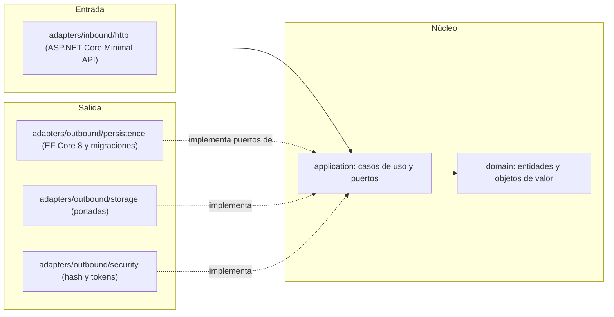
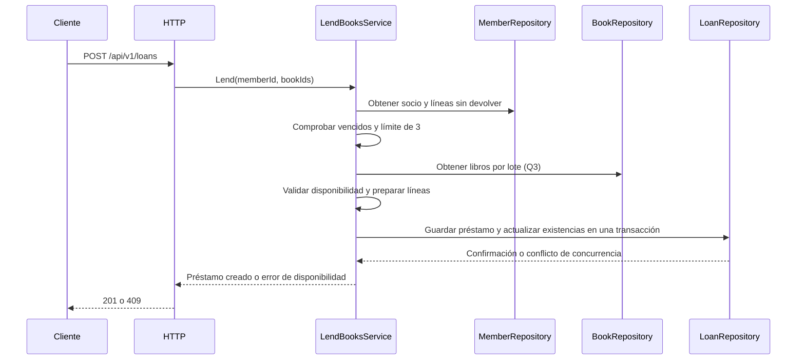

# Arquitectura — Manager Library (.NET)

Arquitectura **hexagonal** (puertos y adaptadores). Las reglas de dependencia son los artículos I a III de [`constitution.md`](constitution.md).

## 1. Capas y dependencias



Las dependencias apuntan hacia el núcleo. `bootstrap` es el único módulo que conecta las implementaciones de los puertos con sus adaptadores.

## 2. Estructura de carpetas

```text
src/
├── Library.Domain/
│   ├── Entities/          # Book, Loan, LoanItem, Member, User
│   └── ValueObjects/      # Isbn, Quantity, DocumentNumber, DateRange
├── Library.Application/
│   ├── Ports/
│   │   └── Outbound/      # BookRepository, LoanRepository, MemberRepository,
│   │                      # UserRepository, ReportReader, Clock,
│   │                      # PasswordHasher, TokenIssuer, CoverStorage
│   └── Services/          # Casos de uso
├── Library.Adapters/
│   ├── Inbound/
│   │   └── Http/          # Endpoints, peticiones y manejo de errores
│   └── Outbound/
│       ├── Persistence/   # EF Core y repositorios
│       ├── Storage/       # Almacenamiento de portadas
│       └── Security/      # Hash de claves y tokens
└── Library.Bootstrap/
    └── Composition/
        └── PortBindings.cs
```

Esta estructura describe la separación lógica de los proyectos. Los nombres y las rutas definitivas deben coincidir con los proyectos y directorios reales del repositorio.

## 3. Agregados

| Raíz | Contiene | Invariantes que defiende |
|---|---|---|
| `Book` | `Isbn`, copias totales y disponibles, baja lógica | Disponibles entre 0 y el total; total ≥ 1; título no vacío. Las restricciones de base de datos pendientes se implementan según T-18. |
| `Loan` | Colección de `LoanItem` | De 1 a 3 líneas; sin libros repetidos; vencimiento a 14 días; el préstamo no se modifica ni se elimina después de registrarse, salvo la devolución de cada línea. |
| `Member` | Documento | Documento obligatorio y único. |
| `User` | Rol y hash | Nombre de usuario normalizado; rol limitado a `admin` o `librarian`. |

`Loan.AddItem` utiliza `Book.Withdraw` antes de añadir la línea. La creación del préstamo, la creación de sus líneas y la actualización de las existencias deben confirmarse como una sola operación transaccional.

`Loan.ReturnItem` utiliza `Book.Restock` una sola vez por línea. Una devolución repetida no debe incrementar nuevamente las existencias.

## 4. Flujo: registrar un préstamo



La operación debe garantizar que dos solicitudes concurrentes no presten el mismo último ejemplar. La actualización de existencias y el registro del préstamo se confirman juntos o se revierten juntos.

## 5. Errores

El dominio y la aplicación utilizan errores propios, como `BookNotAvailable`, `MemberHasOverdue` y `MemberLimitExceeded`. El adaptador HTTP los traduce al cuerpo de error uniforme y al código de estado definidos en [`api-contract.md`](api-contract.md).

Los errores internos del framework no deben exponer detalles de implementación, información sensible ni trazas al cliente. Los códigos de estado y los códigos de error concretos deben coincidir con el contrato HTTP.

## 6. Qué no hay

Sin eventos, sin colas, sin caché, sin microservicios y sin multi-tenencia. Estas capacidades solo se añadirán si un requisito del proyecto lo solicita.
